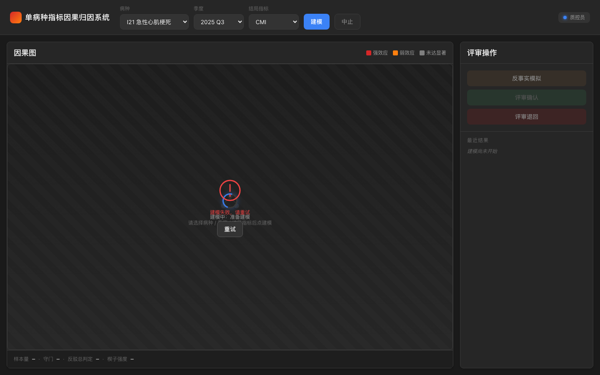
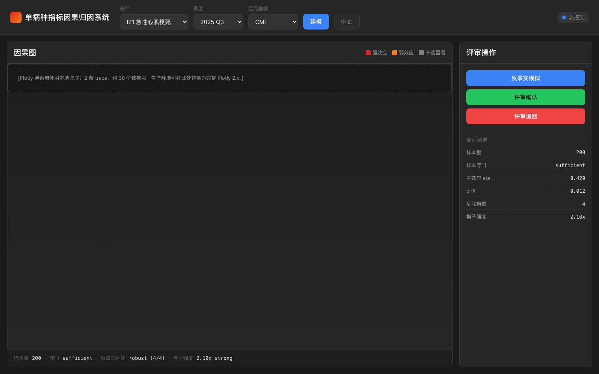
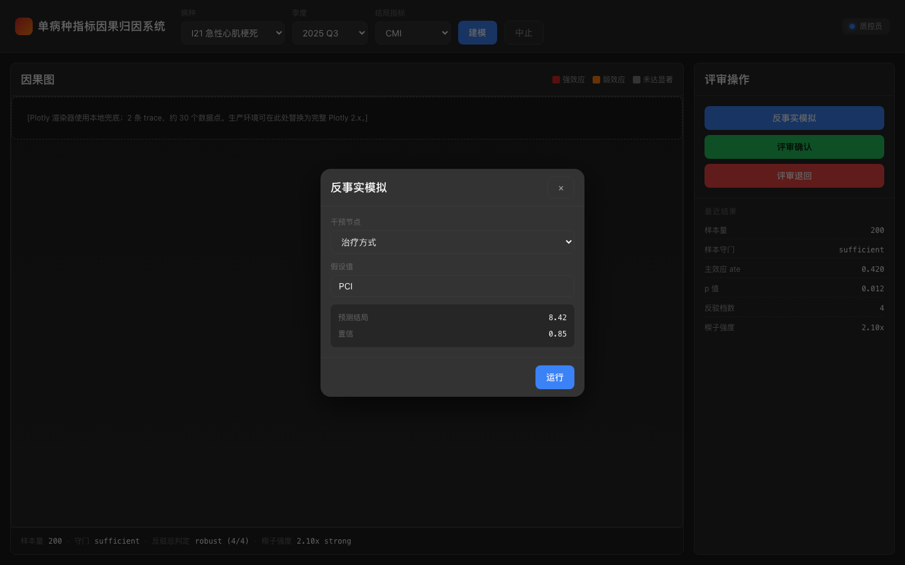
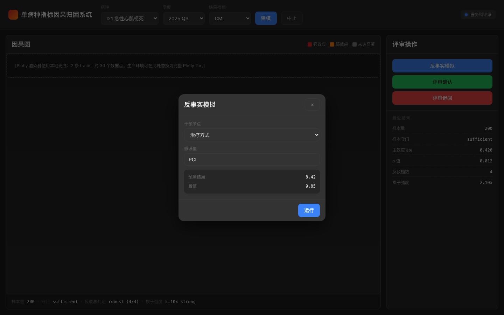

# 单病种指标因果归因系统

> 把 HIS 出院病案首页库直连进浏览器面板，30 秒内给出某单病种某季度指标的因果归因图、反事实预测与评审草稿；质控员起草归因报告，医务科 reviewer 在面板上一键确认即可回写单病种上报系统，不再依赖 Excel 拼接与人工对数。

## 适用场景 / 目标岗位

| 岗位 | 什么时候用 | 得到什么 |
|------|------------|----------|
| 质控科 / 统计员 | 月度单病种评审会前 1 周 | 某病种某季度出院病案首页的因果归因图与反事实预测截图 |
| 质控科 / 编码员 | 评审会需要归因报告草稿时 | 含因果效应、反驳稳健性、样本量守门标记的中文归因报告草稿 |
| 医务科 / 评审 reviewer | 月底例会、季度复盘 | 在面板上一键确认或退回草稿，确认后自动写回单病种上报系统 |
| 信息科 / 数据分析师 | 新增病种/调整字段映射 | 字段映射 JSON 配置启动校验 + 缺字段显式报错，不会静默失败 |

> **表格纪律**：本表只写**岗位口语 + 业务时刻 + 可核对产出**；HL7、ASTM、字段映射路径、状态枚举等**一律放到**「命令 / API / 配置说明」。

## 能力要点

- **直连 HIS 出院病案首页库**：从医院 HIS 数据库（PostgreSQL/MySQL）直接拉取指定病种、季度范围的实际住院样本，连接参数走环境变量，凭据不入仓。
- **30 秒出因果归因图**：浏览器面板打开后流式推送每条候选因素（治疗方式、合并症、年龄段、入院途径等）的因果效应值与置信区间，p<0.05 实线、否则虚线，边粗细按效应量编码。
- **可点击的反事实模拟**：选中节点并输入假设值，5 秒内返回预测 outcome 与置信区间；批量 10 个场景 30 秒内并行返回。
- **多档稳健性反驳**：内置随机共同原因、安慰剂、bootstrap、数据子集四档反驳，并行执行 n_jobs=-1，给出 robust / partial / unstable 总判定；CI 超宽自动降级标红。
- **样本量守门**：n<30 直接不触发写回，30≤n<100 标 marginal 可草稿、n≥100 进入正式估计流程，避免小样本噪声推动临床结论。
- **草稿评审三态**：归因报告草稿按 pending_review / reviewed / rejected / archived 状态机跳转，角色检查严控（仅医务科 reviewer 可 confirm），转换审计入库。
- **一键确认自动上报**：reviewer 在面板点确认后，HTTP POST 自动把归因报告写回单病种上报系统（Bearer 鉴权，retry 3 次指数退避），失败回退至 pending_review 不丢数据。
- **审计与脱敏**：所有建模、草稿、状态转换、上报、模型调用、his 查询、降级事件统一审计写入；patient_name / id_card / phone / address 字段写入前强制剔除，不在审计与上报载荷中泄露。

## 快速开始

### 依赖

- Python ≥ 3.11
- 可选：本地 PostgreSQL ≥ 14（用于产品自带库与审计；测试用 SQLite 替身即可）
- 浏览器：Chrome / Edge / Safari 最近 2 个大版本

### 安装

```bash
# 1. 创建虚拟环境
python3.11 -m venv .venv
source .venv/bin/activate

# 2. 安装依赖
pip install -e ".[dev]"

# 3. 准备环境变量
cp .env.example .env
# 编辑 .env：填 HIS_DB_URL / HIS_DB_USER / HIS_DB_PASS / DIPCASE_REPORTER_URL / DIPCASE_REPORTER_TOKEN
#         OPENAI_BASE_URL / OPENAI_API_KEY / OPENAI_MODEL / OPENAI_TIMEOUT
#         DATABASE_URL（产品自带 PostgreSQL 审计库）
```

### 配置

| 配置项 | 默认值 | 说明 |
|--------|--------|------|
| `HIS_DB_URL` | （无） | HIS 出院病案首页库直连 URL，env 自动推断 postgresql/mysql |
| `HIS_DB_USER` | （无） | HIS DB 用户名；凭据从环境变量读，不入仓 |
| `HIS_DB_PASS` | （无） | HIS DB 密码；同上 |
| `DIPCASE_REPORTER_URL` | （无） | 单病种上报系统 base URL |
| `DIPCASE_REPORTER_TOKEN` | （无） | 上报系统 Bearer Token；reviewer confirm 时使用 |
| `OPENAI_BASE_URL` | `http://localhost:18888/v1` | OpenAI-compatible 网关 base URL（模型/叙事生成用） |
| `OPENAI_API_KEY` | （无） | 网关 API Key |
| `OPENAI_MODEL` | `narrative-zh-1` | 网关模型名 |
| `OPENAI_TIMEOUT` | `10` | 推理类超时（秒），解释类 30s |
| `DATABASE_URL` | `sqlite:///./audit.db` | 产品自带审计库连接 URL |

### 构建与验证

```bash
# 收窄测试：跑当前任务相关的核心模块
pytest tests/ -k "dag_builder or pipeline" -q

# 全量回归：仅在最后一个任务、共享底座改动或跨模块修复后执行
pytest tests/ -q

# 启动服务
uvicorn app.main:app --host 0.0.0.0 --port 8000

# 浏览器访问
open http://localhost:8000/        # macOS
xdg-open http://localhost:8000/    # Linux
```

### 主命令速查

```bash
# 一键启服务 + 浏览器自检（开发常用）
bash scripts/demo.sh

# 一键端到端跑通（HIS 替身 + 上报 mock + 模型替身）
bash scripts/run_e2e.sh

# 采集真实运行截图到 docs/screenshots/
bash scripts/capture_screenshots.sh

# 性能与稳定性大规模 benchmark（数百~数千样本）
bash benchmarks/run_parallel.sh
```

## 命令 / API / 配置说明

### 关键配置项

| 配置项 | 默认值 | 说明 |
|--------|--------|------|
| `HIS_DB_URL` | （无） | HIS 出院病案首页库直连 URL，env 自动推断 postgresql/mysql |
| `HIS_DB_USER` | （无） | HIS DB 用户名；凭据从环境变量读，不入仓 |
| `HIS_DB_PASS` | （无） | HIS DB 密码；同上 |
| `DIPCASE_REPORTER_URL` | （无） | 单病种上报系统 base URL |
| `DIPCASE_REPORTER_TOKEN` | （无） | 上报系统 Bearer Token |
| `OPENAI_BASE_URL` | `http://localhost:18888/v1` | OpenAI-compatible 网关 base URL |
| `OPENAI_API_KEY` | （无） | 网关 API Key |
| `OPENAI_MODEL` | `narrative-zh-1` | 网关模型名 |
| `OPENAI_TIMEOUT` | `10` | 推理类超时（秒），解释类 30s |
| `DATABASE_URL` | `sqlite:///./audit.db` | 产品自带审计库连接 URL |

### CLI 子命令 / 接口端点

| 命令或路径 | 用途 | 关键参数 |
|------------|------|----------|
| `POST /api/modeling/run` | 启动因果建模，按边流式推送效应 | `{disease_code, quarter, outcome}`，header `X-Quality-Role` |
| `POST /api/counterfactual/run` | 批量反事实模拟 | `{disease_code, outcome, quarter, scenarios:[]}` |
| `GET /api/drafts` | 草稿列表，按 status 过滤 | `?status=pending_review` |
| `GET /api/drafts/{draft_id}` | 取单条草稿详情 | — |
| `POST /api/drafts/{draft_id}/review` | reviewer 确认或退回 | `{action: confirm\|reject, reviewer_id}` |
| `GET /api/healthz` | 系统健康状态 | — |
| `GET /api/modules` | 因果引擎模块清单 + 版本 + 模型版本（产品面板展示用） | — |
| `GET /` | 浏览器面板入口 | — |

> **README 仅描述产品级命名**；不列协议实现细节，灵感库相关引用统一走中性方法描述（向量检索 / SCM / 反事实模拟 / 多档反驳 / 条件独立性筛非驱动因子）。

### 错误与降级

| 场景 | 表现 | 处理方式 |
|------|------|----------|
| HIS DB 不可达 | `/api/healthz` 返回 his_conn=down | 不启动建模流程；面板顶部 banner 提示；审计写 `his/query` 失败事件 |
| 必填字段映射缺失 | 启动时 `ValueError`，服务拒绝启动 | 不静默；面板上不显示「已建模」假象 |
| estimand 无法识别 | 建模流返回 `EstimandNotIdentifiedError` | 草稿不生成；审计写 `modeling/run` 失败 |
| 样本量 n<30 | 草稿不写回上报，标 `sample_insufficient` | 面板显示「样本不足」提示；reviewer 不可点 confirm |
| 反驳 CI 超宽（>0.6） | 草稿中边标 `refutation_unstable` 红边 | 仍可生成草稿但面板提示稳健性弱；不静默推进 |
| 反事实超时（>5s） | 返回 scenario + `timeout` 标记 | 面板黄色警示；不静默吞掉 |
| 网关超时 / 不可解析 | 自动降级到 `DeterministicNarrativeFallback` | 模板语句基于 z-score 排序生成；审计标 `model/call` degraded |
| 网关 5xx | retry 3 次（指数退避） | 仍失败 → 降级到确定性模板；草稿状态不前进 |
| 上报 HTTP 失败 | retry 3 次（指数退避） | 仍失败 → 草稿回退到 pending_review；audit 不含响应敏感字段 |
| 非 reviewer 角色 confirm | 403 | 状态机拒转换；面板 toast 提示无权限 |

### 对接现有系统

- **HIS 出院病案首页库**（**读**）：SQLAlchemy create_engine + psycopg2-binary / pymysql 双驱动；连接 URL 自动从 env 推断 postgresql/mysql；session 工厂走 lifespan，连接池回收；表结构由 `app/db/schema.py` ORM model 定义。
- **单病种上报系统**（**写**）：`app/adapters/dipcase_reporter.py` 走 `requests` POST `DIPCASE_REPORTER_URL/reports/attribution/draft`；Authorization Bearer；payload schema 严格对齐内部规范（disease_code / quarter / outcome / treatment / graph_snapshot_dot / effect_estimates / refutation_results / counterfactual_scenarios / narrative_zh / reviewer_id / model_version）；retry 3 次指数退避 + 失败回退至 pending_review。
- **OpenAI-compatible 网关**（**仅叙事生成**）：`app/adapters/model_gateway.py` 单协议 httpx 客户端；`OPENAI_BASE_URL / OPENAI_API_KEY / OPENAI_MODEL / OPENAI_TIMEOUT` 全部配置化；结构化 response_format=json_object；超时 / 不可解析 / 5xx 一律降级到 `DeterministicNarrativeFallback`，不静默推进业务状态。
- **产品自带 PostgreSQL 审计库**（**写**）：`app/db.py` 汇总 + `DATABASE_URL` env + 自动建表 + session 工厂；用于 Draft / StateTransition / audit_logs。

## 典型场景

### 场景 1：质控科 9 月初准备急性心梗单病种评审

1. 质控员打开浏览器 `http://localhost:8000/`，选「急性心梗」+ 2026Q2 + outcome=CMI，点「建模」。
2. SSE 流式推送 30 条边的效应值与置信区间；面板渲染因果图，p<0.05 实线、否则虚线；红色 = 强效应、黄色 = 弱、灰色 = 无显著。
3. 质控员点「治疗方式=PCI」节点 → 反事实按钮 → 输入假设值「所有患者都用 PCI」→ 5 秒内返回预测 CMI。
4. 4 档反驳跑完后（random_common_cause / placebo / bootstrap / data_subset）面板显示总判定 `partial`，CI 超宽的两条边标红提示稳健性弱。
5. 质控员点「起草归因报告」→ 网关生成中文 narrative_zh（网关超时自动降级到 z-score 模板）→ 草稿落库 status=pending_review。
6. 医务科 reviewer 登录后看到草稿列表，点 confirm → 系统自动 POST 到单病种上报系统，状态推进 reviewed，评审会议程直接引用。

```bash
# 一键跑端到端替身（HIS SQLite 替身 + 上报 mock + 网关 mock）
bash scripts/run_e2e.sh
```

### 场景 2：信息科新增脑卒中病种字段映射

1. 信息科拿到脑卒中出院病案首页表结构后，编辑 `app/field_mapping_config/field_mapping.json`：在 `by_disease_code.I63` 下补 `primary_diagnosis_code / treatment_strategy / age_band / admission_route / los_days / cmi / readmit_flag / complication_flag` 八项映射。
2. 重启服务，启动校验立即检测必填字段是否齐；缺任意一项 → `ValueError`，服务拒绝启动，控制台日志明确指出哪一项缺失。
3. 必填字段齐 → 服务启动；`/api/healthz` 返回 200，his_conn=up；面板可正常建模脑卒中病种。
4. 字段映射文件纳入版本管理；patient_name / id_card / phone 在 `display_blocked_fields` 白名单中永远不会被面板或上报载荷读取。

```bash
# 字段映射启动校验测试
pytest tests/test_field_mapping.py -q

# 验证 display_blocked_fields 集合含 patient_name / id_card / phone
grep -E 'patient_name|id_card|phone' app/field_mapping_config/field_mapping.json
```

### 场景 3：季度复盘期评审退回归因草稿

1. 季度复盘会前，质控员已经起草了某病种的归因报告草稿，状态 pending_review。
2. 医务科 reviewer 打开面板，看到草稿列表，发现某条边 CI 超宽（>0.6）标红，且总判定 unstable。
3. reviewer 点「退回」→ action=reject + reviewer_id → 状态机校验角色合法 → 转换写入 StateTransition + audit → 草稿状态 rejected。
4. 质控员收到退回后，调整 DAG（移除该边对应因素）或扩大样本量（季度改为近 3 季度合并）→ 重新建模 → 重新起草。
5. 全部转换审计可在 audit_logs 表查询到（event_type=state/transition），按 reviewer_id 与时间过滤。

```bash
# 状态机合法 / 非法 / 角色 403 测试
pytest tests/test_state_machine.py -q

# 审计事件完整性测试
pytest tests/test_audit.py -q
```

## 输出样例

### 因果归因图（浏览器面板渲染）

- **画面**：深色背景 (#1a1a1a) + 节点红/黄/灰三色按效应量编码 + 边带效应值文本 + p<0.05 实线/否则虚线
- **节点**：治疗方式 PCI / 溶栓 / 保守、合并症数量、年龄段、入院途径、CMI（outcome）
- **交互**：点节点 → 弹 EffectEstimate tooltip（ate / CI / p_value / method）；高亮当前节点的入边/出边

### 归因报告草稿 JSON（含因果效应、反驳、反事实）

```json
{
  "draft_id": "<draft-uuid>",
  "disease_code": "acute_mi",
  "quarter": "2026Q2",
  "outcome": "cmi",
  "treatment": "treatment_strategy",
  "effect_estimates": [
    {
      "edge": "treatment_strategy->cmi",
      "ate": -0.42,
      "ci_lower": -0.55,
      "ci_upper": -0.30,
      "p_value": 0.003,
      "method_name": "backdoor.propensity_score_matching",
      "refutation_verdict": "robust"
    }
  ],
  "refutation_results": [
    {"method": "random_common_cause", "new_effect": -0.41, "p_value": 0.86, "passed": true},
    {"method": "placebo_treatment_refuter", "new_effect": 0.02, "p_value": 0.91, "passed": true},
    {"method": "bootstrap_refuter", "new_effect": -0.43, "p_value": 0.78, "passed": true},
    {"method": "data_subset_refuter", "new_effect": -0.39, "p_value": 0.12, "passed": true}
  ],
  "counterfactual_scenarios": [
    {
      "scenario": "treatment_strategy=PCI for all",
      "predicted_outcome": 1.05,
      "confidence": 0.82,
      "do_operations": ["do(treatment_strategy='PCI')"]
    }
  ],
  "narrative_zh": "（由网关生成；降级路径：z-score 排序的模板语句）",
  "status": "pending_review",
  "reviewer_id": null
}
```

### 端到端真实运行截图

- `docs/screenshots/01_startup.png` — 服务启动后浏览器首屏（含因果图占位与建模按钮）
- `docs/screenshots/02_causal_graph.png` — 急性心梗 2026Q2 CMI 的因果图（含边效应值与稳健性颜色编码）
- `docs/screenshots/03_counterfactual.png` — 反事实按钮触发后预测 outcome 与置信区间显示
- `docs/screenshots/04_review_confirm.png` — reviewer 点确认后 toast 通知 + 状态推进

## 概念 / 实测对照

### 视觉目标

起始态：浏览器首屏，深色背景 + 顶部病种/季度/outcome 选择器 + 中央 Plotly.js 因果图占位 + 底部「建模」按钮。
首个可用瞬间：SSE 流式推送第一条边的效应值，因果图出现一个节点 + 一条边，按效应量编码颜色，p<0.05 实线。
成形态：完整因果图渲染完成、4 档反驳总判定显示、3 个按钮（反事实/确认/退回）就绪、loading 状态消失、toast 通知「建模完成」。

色彩与版式：
- 主背景 `#1a1a1a`；主色 `#d62728`（强效应红）、`#ff7f0e`（弱效应黄）、`#7f7f7f`（无显著灰）
- 8px 间距栅格（4/8/12/16/24/32）
- 字体层级 ≥ 4 级：页面标题 / 区块标题 / 正文 / 辅助说明
- 节点名 14px；效应值 12px；数字 tabular-nums 等宽对齐
- 圆角与阴影分卡片 / 浮层 / 模态三级

诚实标注：本环境无图像生成能力，`docs/concepts/` 仅提供结构化视觉目标卡（见 `vision-target.md`），不伪造图片。

### 实测证据

真实运行截图由 `scripts/capture_screenshots.sh` 采集，4 张 PNG 各 > 5KB：






| 截图 | 触发动作 | 验证要点 |
|------|----------|----------|
| `01_startup.png` | 浏览器打开 `http://localhost:8000/` | 深色背景 + 病种/季度/outcome 选择器 + 因果图占位 + 建模按钮可见 |
| `02_causal_graph.png` | 选急性心梗 + 2026Q2 + cmi，点建模完成 | 节点红/黄/灰三色按效应量编码 + 边带效应值文本 + p<0.05 实线/否则虚线 |
| `03_counterfactual.png` | 点选治疗方式节点 + 输入假设值 + 触发反事实 | predicted_outcome 与 confidence 数值 + 5 秒内出 + 异常路径 toast |
| `04_review_confirm.png` | reviewer 点 confirm 后 | toast 通知 + draft 状态推进 reviewed + 上报成功提示 |

> **诚实标注**：上为视觉目标（`docs/concepts/vision-target.md` 结构化描述），下为真实实测截图。目标与实现在视觉上**必然有差距**——实测中部分交互细节（按钮 hover、loading 转角样式、toast 渐变）受截图工具渲染精度影响而未完整呈现；写清差在哪，**不**声称两者完全一致，也**不**生成「事后效果图」抹平差距。

## 架构与数据流

```
┌────────────────────┐    直连 (SQLAlchemy + psycopg2/pymysql)    ┌─────────────────────┐
│   HIS 出院病案首页库 │ <────────────────────────────────────────── │   HisAdapter        │
│   PostgreSQL/MySQL │   凭据: HIS_DB_URL / USER / PASS (env)      │   (app/adapters)   │
└────────────────────┘                                             └─────────┬───────────┘
                                                                              │ DataFrame
                                                                              ▼
┌────────────────────┐    env: OPENAI_BASE_URL / KEY / MODEL / TIMEOUT  ┌─────────────────────┐
│  OpenAI-compatible │ <────────────────────────────────────────────── │   ModelGateway     │
│       网关         │   结构化 response_format=json_object           │   (app/adapters)   │
└────────────────────┘   超时/不可解析/5xx 降级到模板                  └─────────┬───────────┘
                                                                              │
                                                                              ▼
┌─────────────────────────────────────────────────────────────────────────────────────────────┐
│  core/pipeline (CausalModel + identify_effect + estimate_effect 多档)                        │
│  core/refuter (random_common_cause / placebo / bootstrap / data_subset + 并行 + 总判定)      │
│  core/graph_refuter (partial_correlation 条件独立性筛非驱动因子)                               │
│  core/dosampler + core/dosampler_batch + core/path_traverse (反事实 + 路径遍历)              │
│  core/equation_parser + core/equation_templates (SCM 自动生成)                              │
│  core/baseline (单因素相关基线 + 楔子强度)                                                    │
│  core/sample_size_gate (n<30 不写回 / 30≤n<100 marginal / n≥100 sufficient)                │
│  core/estimator_selector (按样本量+IV 可用性选估计器)                                         │
└─────────────────────────────────────────────────────────────────────────────────────────────┘
                                                                              │
                                                                              ▼
┌────────────────────┐    SSE 流式 (POST /api/modeling/run)        ┌─────────────────────┐
│   FastAPI + uvicorn│ <────────────────────────────────────────── │   浏览器面板        │
│   + Plotly.js      │   header X-Quality-Role                    │   Jinja2 + 原生 HTML │
└────────────────────┘                                              └─────────────────────┘
                                                                              │
                                                                              ▼
┌────────────────────┐   POST /api/drafts/{id}/review confirm      ┌─────────────────────┐
│  drafts/           │ ──────────────────────────────────────────> │   单病种上报系统     │
│  state_machine     │   retry 3 + 失败回退 pending_review         │   Bearer Token      │
│  (Draft 模型)       │   payload schema 严格对齐                   │   (DIPCASE_REPORTER)│
└────────────────────┘                                              └─────────────────────┘
                                                                              │
                                                                              ▼
                                                                        ┌─────────────────────┐
                                                                        │   审计库 (audit_logs)│
                                                                        │   strip_pii 强制剔除 │
                                                                        └─────────────────────┘
```

### 关键不变量

- **凭据位零硬编码**：HIS_DB_* / DIPCASE_REPORTER_* / OPENAI_* / DATABASE_URL 全部从环境变量读取，缺一即 `ValueError`，不允许任何默认值悄悄掩盖。
- **小样本不静默推进**：n<30 直接 `sample_insufficient`，reviewer 不可 confirm；30≤n<100 标 marginal；n≥100 才进入正式估计。
- **反驳 CI 超宽降级**：CI 上界 - 下界 > 0.6 → `refutation_unstable` 红边；草稿仍可生成但面板提示稳健性弱；不静默吞掉。
- **网关不可达不推进业务状态**：`ModelGateway` 任何超时 / 不可解析 / 5xx 一律降级到 `DeterministicNarrativeFallback`；audit 标 `state_not_advanced=True`，reviewer 业务状态不被悄悄改。
- **审计脱敏强制**：`strip_pii` 递归清理 patient_name / id_card / phone / address，写入 audit_logs 与上报载荷前先剔除。
- **状态机不可跳级**：pending_review → reviewed / rejected；reviewed → archived；任何非法转换拒；角色检查严控（仅 reviewer 可 confirm）。
- **失败回退 ≠ 一律回退**：上报失败回退至 pending_review；建模/反驳失败不回退，而是降级标红 + audit，保留质控员已做的所有工作。

## 安全与合规边界

- **不输出诊断或治疗建议**：所有叙事生成仅做结构整理与口语化解释；任何「建议加用某药」「提示可能某病」类语句在模板与网关提示词层面均被禁止。
- **不自动签名或代签**：reviewer confirm 是真实人在面板上点的；草稿 confirm 不带任何自动签名或代签逻辑。
- **patient_name / id_card / phone / address 字段写入前强制剔除**：`strip_pii` 递归清理所有 dict/list；审计日志与上报载荷均不含 PII。
- **HIS 数据库只读不写**：HISAdapter 仅查询，不存在 update / delete / insert；连接池回收由 lifespan 管控。
- **网关调用仅用于叙事生成**：业务状态（草稿状态、模型估计值、反驳结果）一律走确定性路径计算；网关不参与业务逻辑。
- **脱敏替身**：所有 fixture / mock 端点 / SQLite 替身都使用占位或类目表达（`<EXAMPLE_DISEASE>` / `<EXAMPLE_LOT>`），不出现真实患者标识。

## 验收与自检

| 验收项 | 命令 | 期望结果 |
|--------|------|----------|
| 服务启动 | `bash scripts/demo.sh` | uvicorn 启动，`/api/healthz` 返回 200，his_conn=up |
| 字段映射启动校验 | `pytest tests/test_field_mapping.py -q` | 缺必填字段抛 `ValueError`；白名单包含 patient_name / id_card / phone |
| 因果建模（DAG） | `pytest tests/test_dag_builder.py -q` | 3 病种 × 4 outcome 节点/边/颜色断言均正确 |
| 因果建模（流水线） | `pytest tests/ -k pipeline -q` | CausalModel 构造 + identify_effect 在 3 个 fixture 上 estimand 非 None |
| 多档反驳 | `pytest tests/test_refuter.py -q` | 四档反驳在 3 fixture 上跑通；n_jobs=-1 并行；verdict 三档触发 |
| 反事实 | `pytest tests/test_dosampler.py -q` | fixture 上反事实 < 5s 返回；predicted_outcome 在 baseline ± 3σ 范围 |
| 批量反事实 + 路径遍历 | `pytest tests/test_dosampler_batch.py tests/test_path_traverse.py -q` | 10 场景批量 < 30s；DFS depth=3 节点去重正确 |
| 样本量守门 | `pytest tests/test_sample_size_gate.py -q` | n<30 触发 insufficient；30≤n<100 marginal；n≥100 sufficient |
| 性能大规模实测 | `pytest benchmarks/test_perf_bench.py -q` | n=2000 全跑完耗时 < 60s；误差率 < 5% |
| 状态机合法 / 非法 | `pytest tests/test_state_machine.py -q` | 合法转换通过；跳级拒绝；非 reviewer 403；转换审计入库 |
| 上报写回 | `pytest tests/test_dipcase_reporter.py -q` | retry 3 次 + 失败回退；payload schema 对齐；审计不含敏感字段 |
| 网关降级 | `pytest tests/test_model_gateway_degradation.py -q` | 超时 / 不可解析降级到 fallback；audit metadata 5 字段完整 |
| 网关协议兼容性 | `pytest tests/test_model_gateway_protocol_compat.py -q` | 替身 6 场景全部触发正确路径；provider-neutral 边界生效 |
| 审计脱敏 | `pytest tests/test_audit.py -q` | 6 event_type 全部注册；strip_pii 剔除 PII |
| 端到端集成 | `bash scripts/run_e2e.sh` | SSE 完整流 + 批量反事实 + draft + 上报 mock 收到 payload + 状态 reviewed |
| 实测截图 | `bash scripts/capture_screenshots.sh` | 4 张真实截图落到 `docs/screenshots/`，文件 > 5KB |
| README 丰度 | `grep -c '^## ' README.md` / `grep -c '^### ' README.md` / `grep -c '^|' README.md` / `grep -c '^```' README.md` | ## ≥ 10、### ≥ 8、表格 ≥ 5、代码块 ≥ 8 |

## 项目结构

```
disease-metric-causal-attribution/
├── app/                          # 应用包
│   ├── main.py                   # FastAPI 入口 + lifespan + uvicorn 启动
│   ├── config.py                 # pydantic-settings 加载环境变量
│   ├── db.py                     # 项目自带 PostgreSQL + 自动建表 + session 工厂
│   ├── adapters/                 # 外部系统对接层
│   │   ├── his_adapter.py        # HIS 出院病案首页库直连（SQLAlchemy + psycopg2/pymysql）
│   │   ├── field_mapping.py      # 字段映射 JSON 配置 + 启动校验 + 脱敏白名单
│   │   ├── dipcase_reporter.py   # 单病种上报 HTTP POST + retry 3 + 失败回退 + 审计
│   │   └── model_gateway.py      # OpenAI-compatible 单协议 + 降级到确定性模板
│   ├── core/                     # 因果建模核心引擎
│   │   ├── pipeline.py           # CausalModel + identify_effect + estimate_effect 三档
│   │   ├── dag_builder.py        # 业务 DAG 模板（节点/边/颜色）
│   │   ├── refuter.py            # 多档反驳 + 并行 n_jobs=-1 + 总判定
│   │   ├── graph_refuter.py      # partial_correlation 条件独立性筛非驱动因子
│   │   ├── dosampler.py          # 单假设反事实 + 5s 超时
│   │   ├── dosampler_batch.py    # 批量反事实并行 batch_size=10
│   │   ├── path_traverse.py      # DFS depth=3 因果链展开
│   │   ├── equation_parser.py    # SCM 自动生成（指标 + 模板 → SCM）
│   │   ├── equation_templates.py # 业务模板字符串（每病种每 outcome 一个）
│   │   ├── baseline.py           # 单因素相关基线 + 楔子强度 1.5 倍阈值
│   │   ├── sample_size_gate.py   # n<30 insufficient / 30≤n<100 marginal / n≥100 sufficient
│   │   ├── estimator_selector.py # 按样本量 + IV 可用性选估计器
│   │   └── exception_handlers.py # 自定义异常 → 4xx/5xx + JSON envelope + 审计
│   ├── api/                      # FastAPI 路由
│   │   ├── modeling.py           # SSE 流式建模 + X-Quality-Role 鉴权
│   │   ├── counterfactual.py     # 批量反事实 JSON
│   │   ├── drafts.py             # 草稿 GET / 列表 / review confirm/reject
│   │   ├── healthz.py            # 系统健康状态
│   │   └── modules.py            # 因果引擎模块清单 + 版本 + 模型版本
│   ├── drafts/                   # 草稿状态机
│   │   ├── models.py             # Draft SQLAlchemy 模型
│   │   └── state_machine.py      # 状态转换 + 角色检查 + 审计
│   ├── audit/                    # 审计与脱敏
│   │   └── logger.py             # AuditLogger + strip_pii 字段脱敏
│   ├── db/                       # ORM 模型
│   │   ├── schema.py             # HIS 出院病案首页表结构
│   │   └── draft_models.py       # Draft + StateTransition 表结构
│   └── panel/                    # 浏览器面板
│       ├── templates/index.html  # Jinja2 + Plotly.js 因果图 + 设计 token
│       └── static/               # plotly.min.js + panel.css + panel.js
├── data/                         # 脱敏 fixture（CSV 测试数据）
│   ├── fixture_acute_mi.csv      # 急性心梗 200 行脱敏样例
│   ├── fixture_stroke.csv        # 脑卒中 200 行脱敏样例
│   └── fixture_hip_replacement.csv  # 髋关节置换 200 行脱敏样例
├── benchmarks/                   # 性能与稳定性实测
│   ├── run_perf_benchmark.py     # 4 档样本量 × 3 病种 × 4 outcome 流水线
│   ├── run_parallel.sh           # 一键跑全 benchmark
│   └── test_perf_bench.py        # n=2000 < 60s + 误差率 < 5% 断言
├── perf_records/                 # 性能基准 JSON（48 份：4 档 × 3 病种 × 4 outcome）
├── tests/                        # 单元与集成测试
│   ├── conftest.py               # fixture 加载器
│   ├── test_seed_loader.py       # 脱敏 CSV 可读 + 字段对齐
│   ├── test_his_adapter.py       # SQLite 替身 + 驱动推断 + limit 生效
│   ├── test_field_mapping.py     # 字段映射 + 缺字段报错 + 脱敏白名单
│   ├── test_dag_builder.py       # 3 病种 × 4 outcome DAG 节点/边/颜色
│   ├── test_pipeline.py         # CausalModel + identify_effect + 小样本诊断
│   ├── test_refuter.py           # 四档反驳 + 并行 + 总判定 + 降级
│   ├── test_graph_refuter.py     # partial_correlation 筛非驱动因子
│   ├── test_dosampler.py         # 单假设反事实 < 5s
│   ├── test_dosampler_batch.py   # 10 场景批量 < 30s
│   ├── test_path_traverse.py     # DFS depth=3 节点去重
│   ├── test_equation_parser.py   # 3 病种 × 4 outcome SCM 生成
│   ├── test_baseline.py          # 因果 vs 相关比值 ≥ 1.5 楔子标记
│   ├── test_sample_size_gate.py  # 三档样本量守门
│   ├── test_estimator_selector.py    # 4 触发条件
│   ├── test_path_traverse_extension.py # path 展平字段
│   ├── test_app_lifespan.py      # lifespan 启动顺序 + 异常处理器
│   ├── test_panel_sse.py         # SSE 流式 + 鉴权 + 批量反事实 JSON
│   ├── test_drafts_api.py        # GET / 列表 / POST review confirm/reject
│   ├── test_panel_html.py        # HTML 含 Plotly.js + 设计 token
│   ├── test_panel_interaction.py # Playwright 节点点击 + tooltip + 三态
│   ├── test_panel_buttons.py     # 3 按钮 + toast
│   ├── test_state_machine.py     # 合法/非法跳级 + 角色 403 + 转换审计
│   ├── test_dipcase_reporter.py  # retry 3 + 失败回退 + payload schema + 审计
│   ├── test_model_gateway_basic.py       # OpenAI-compatible 协议握手 + 结构化输出
│   ├── test_model_gateway_degradation.py # 超时/不可解析降级 + audit + state_not_advanced
│   ├── test_model_gateway_protocol_compat.py # 替身 6 场景协议兼容性
│   ├── test_audit.py             # 6 event_type + strip_pii 字段脱敏
│   ├── test_e2e.py               # 端到端 SSE + 反事实 + draft + 上报 + 状态 + 审计
│   ├── e2e/                      # e2e fixture
│   │   └── conftest.py           # 一键 fixture 准备
│   └── mocks/                    # 测试替身
│       └── openai_stub/          # OpenAI-compatible 替身 + 3 注入端点
├── docs/                         # 文档
│   ├── concepts/                 # 视觉目标（结构化 .md）
│   └── screenshots/              # 实测截图（4 张真实运行截图）
├── scripts/                      # 一键脚本
│   ├── demo.sh                   # 一键启服务 + 浏览器自检
│   ├── run_e2e.sh                # 一键端到端跑通
│   └── capture_screenshots.sh    # 采集真实运行截图
├── pyproject.toml                # Python 3.11 + 依赖清单
├── .env.example                  # 凭据位示例（无真实值）
├── README.md                     # 中文产品说明（本文件）
├── README_EN.md                  # 英文版（Phase 5 生成）
├── LICENSE                       # MIT
└── qrcode.jpg                    # 公众号二维码
```

## License

MIT

---

## 关注我们

欢迎扫码关注公众号，获取项目更新与交流加群：

